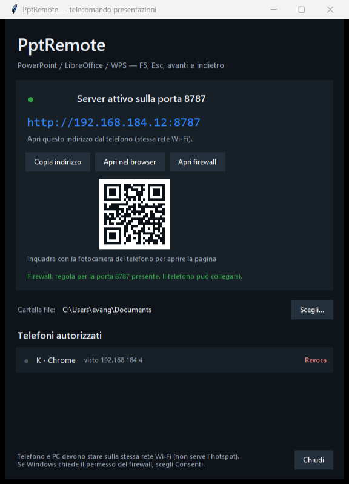
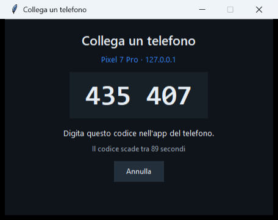

# PptRemote — telecomando presentazioni: Android → PC Windows

Comandi le presentazioni **già aperte** sul PC (PowerPoint, LibreOffice Impress, WPS) dal telefono,
via Wi-Fi: scegli la finestra della presentazione, premi **F5**, poi **avanti / indietro**, **Esc**.

Il PC accetta un telefono solo dopo che hai digitato sul telefono il **codice a 6 cifre** che
compare sullo schermo del computer.
| La finestra sul PC | Il codice di collegamento |
|---|---|
|  |  |


| Il PC (server + indirizzo) | Il codice di collegamento | Il telecomando | Palco (anteprima, contatore, timer) | Ricerca file |
|---|---|---|---|---|

---

## 1. Requisiti

- Windows 10/11 con **Python 3.9+** installato (da python.org, con tkinter incluso).
  Verifica: apri il prompt e scrivi `python --version`.
- **PowerPoint** o **LibreOffice Impress** sul PC, con la presentazione già aperta.
- Telefono **Android** (o iPhone) collegato alla **stessa rete Wi-Fi** del PC.

Nessuna libreria da installare: il server usa solo la libreria standard di Python.

## 2. Avvio sul PC

1. Doppio clic su **`Avvia PptRemote.bat`**.
2. La prima volta Windows mostra la richiesta del firewall: scegli **Consenti**
   (oppure esegui una volta `Consenti nel firewall.bat` come amministratore).
3. Compare la finestra **PptRemote** con l'indirizzo da usare, ad esempio:

   ```
   http://192.168.1.20:8787
   ```

   Il pulsante **Copia indirizzo** lo mette negli appunti.

## 3. Collegare il telefono (una volta sola)

1. Dal telefono inquadra il **QR** della finestra PptRemote (o digita l'indirizzo).
2. Sul PC compare la finestra **Collega un telefono** con un codice a 6 cifre.
3. Digita il codice nel telefono. Fatto: il telefono resta autorizzato.
4. Consigliato: dal menu ⋮ di Chrome scegli **Aggiungi a schermata Home**
   → PptRemote diventa un'icona a schermo intero, come un'app.

Puoi revocare un telefono in qualsiasi momento dalla finestra del PC
(elenco *Telefoni autorizzati* → **Revoca**).

### Provarla subito, anche senza telefono

1. Sulla finestra del PC premi **Apri nel browser**: si apre la stessa pagina sul PC.
2. Compare la finestra con il codice: scrivilo nella pagina e premi i tasti.
3. Apri `samples\demo.pptx` con PowerPoint e prova **F5**, **▶**, **◀**.

## 4. Rete: serve lo stesso Wi-Fi, non l'hotspot

Funziona su **qualsiasi rete dove telefono e PC si vedono tra loro**: Wi-Fi di casa,
ufficio, o anche l'hotspot del telefono (in quel caso il PC si collega all'hotspot e
l'indirizzo cambia: leggi quello nella finestra del PC).

Cose che possono bloccare il collegamento:

| Situazione | Cosa fare |
|---|---|
| Rete Wi-Fi **Pubblica** su Windows | la finestra del PC lo segnala e c'è **Apri firewall**: conferma il prompt di Windows |
| Wi-Fi **ospiti** con isolamento client | usa la rete normale di casa (molti router isolano gli ospiti) |
| Telefono su **dati mobili** | attiva il Wi-Fi |
| **VPN** attiva sul PC o sul telefono | disattivala mentre usi PptRemote |
| L'indirizzo del PC cambia | riapri la pagina leggendo il nuovo indirizzo (o riscansiona il QR) |

Il PC deve avere la regola firewall per la porta 8787: la finestra mostra
*"Firewall: regola per la porta 8787 presente"* in verde quando è tutto a posto.

## 4. Uso

La pagina del telefono ha tre schede, e si cambiano anche **scorrendo col dito**
(swipe a sinistra/destra):

| Scheda | Contenuto |
|---|---|
| **Aperte** | le presentazioni aperte + il riquadro palco (contatore, anteprima, timer, laser) |
| **File** | ricerca nella cartella configurata sul PC, con **Apri** / **Presenta** |
| **Schermo** | specchio dal vivo del monitor del PC, tocchi e il mouse va lì |

Nella scheda **Aperte**:

| Elemento | Cosa fa |
|---|---|
| Tocca una finestra | la porta in primo piano sul PC (ed è quella che riceve i comandi) |
| **✕** sulla finestra | chiude quel file (chiede conferma; se ci sono modifiche non salvate il PC mostra il suo avviso) |
| **◀ / ▶** | slide indietro / avanti |
| **F5 · Avvia** | avvia la presentazione dall'inizio |
| **Esc · Ferma** | termina la presentazione |
| **Shift+F5** | avvia dalla slide corrente |
| **Nero · B** | schermo nero / riprendi |
| **🔴 Laser** (accanto all'anteprima) | accende il puntatore laser; poi **tocchi l'anteprima** dove vuoi indicare |
| **Slide n°** | salta a una slide (digiti il numero, poi **Vai**) |

### Rifiniture da palco

Quando la presentazione è avviata, sopra l'elenco compare il riquadro **palco**:

- **contatore slide** `3 / 12` e **anteprima dal vivo** di quello che è sul proiettore
  (si aggiorna ogni ~2 secondi);
- **timer** del tempo di parola: ▶ avvia, ❚❚ pausa, ↺ azzera; parte da solo al primo F5;
- **puntatore**: **tocca (o trascina) l'anteprima** dove vuoi indicare — il cursore del PC
  va esattamente lì. Compare un pallino rosso sotto il dito per conferma;
- **🔴 Laser** (accanto all'anteprima): attiva il puntatore laser di PowerPoint (`Ctrl+L`).
  Da quel momento il pallino segue il cursore, quindi **tocchi l'anteprima dove vuoi
  indicare** e il puntatore va lì. Funziona con PowerPoint; con LibreOffice il pulsante
  non produce il pallino, ma il cursore si muove lo stesso;
- l'anteprima funziona con qualsiasi programma (PowerPoint, LibreOffice, PDF) perché
  legge i pixel della finestra a schermo intero.

> Il numero della slide è **stimato** dai comandi inviati (F5 = 1, ogni ▶ +1, "vai a"
> salta al numero scelto) e il totale è letto dal file `.pptx`/`.odp`.

### Scheda File: cartella configurabile sul PC

1. La **prima volta** l'app sceglie da sola la cartella con più presentazioni tra
   *Documenti*, *Download* e *Desktop* (di solito è quella giusta: i file appena
   scaricati finiscono in Download).
2. Per cambiarla: sulla finestra del PC premi **Scegli…** accanto a *Cartella file*.
   La riga mostra quante presentazioni ci sono (`12 presentazioni`) oppure
   `nessuna presentazione: premi Scegli…` se hai indicato la cartella sbagliata.
3. Dal telefono apri la scheda **File**: elenco dei `.pptx .ppt .ppsx .odp .pdf` presenti
   (anche nelle sottocartelle), con numero di slide e dimensione.
4. Scrivi nel campo di ricerca per filtrare; **Presenta** apre il file sul PC e avvia
   subito l'F5, **Apri** lo apre soltanto.

Ordinamento dei risultati: prima i file il cui **nome inizia** con il testo cercato,
poi quelli che lo contengono, infine quelli trovati solo nel nome della cartella;
a parità, prima le presentazioni (`.pptx/.odp`) e poi i PDF.
I file di blocco di Office (`~$...`) sono esclusi, e per sicurezza si possono aprire solo
file dentro la cartella scelta.

### Scheda Schermo

Specchio dal vivo del monitor del PC (circa un'immagine al secondo, quindi va bene per
controllare cosa è aperto, non per vedere video). Se hai più monitor compare il selettore
*Schermo 1 / Schermo 2*.

**Tocca un punto dell'immagine** e il mouse del PC va lì: così puoi aprire un file, chiudere
una finestra o usare il laser anche senza guardare il proiettore. Un pallino rosso conferma
il punto toccato.

### Proiettore / secondo schermo

L'app non tocca la configurazione dei monitor: la presentazione parte sullo schermo
che Windows e PowerPoint usano di default. Se il proiettore non è quello giusto:

- **PowerPoint**: scheda *Presentazione* → gruppo *Imposta presentazione* →
  *Mostra su: Monitor 2* (il proiettore).
- **LibreOffice Impress**: *Presentazione* → *Impostazioni presentazione* → scegli il monitor.

Per far riconoscere il proiettore a Windows: `Win + P` → **Estendi**.

## 5. Come funziona (in breve)

```
Telefono (pagina web)  ──HTTP──▶  ppremote.py (PC)
                                     │
                                     ├─ elenca le finestre (winapi.py, Win32)
                                     ├─ porta in primo piano la finestra scelta
                                     └─ invia i tasti: F5, ←, →, Esc, B, numeri
```

Il controllo è volutamente **generico**: non usa le API interne di PowerPoint,
manda i tasti alla finestra della presentazione. Per questo funziona uguale con
PowerPoint, LibreOffice Impress, WPS Office e anche con un PDF a schermo intero.
Se l'app ha una presentazione a schermo intero, i tasti vanno a quella.

### Password / sicurezza

- Il server ascolta solo sulla rete locale e ogni richiesta richiede un **token**
  rilasciato dopo il codice.
- Il codice è monouso, scade dopo **90 secondi** e dopo **5 tentativi errati**
  la richiesta viene bloccata.
- I telefoni autorizzati e i log stanno in `%APPDATA%\PptRemote\`.

## 6. Problemi comuni

| Sintomo | Soluzione |
|---|---|
| Il telefono non apre la pagina | stessa Wi-Fi? firewall? indirizzo giusto (cambia se cambia la rete)? |
| Nessuna finestra nell'elenco | apri prima il file `.pptx` / `.odp` sul PC, poi tocca ⟳ |
| F5 non fa niente | la finestra selezionata non è una presentazione, oppure Windows ha negato il primo piano: clicca una volta la finestra sul PC |
| Il titolo dice **[Protected View]** / **Visualizzazione protetta** | PowerPoint ha aperto il file in isolamento (tipico dei file recuperati dopo un crash): chiudilo e riaprilo da Esplora file, o spostalo in *Documenti* |
| L'anteprima non compare | la presentazione deve essere a schermo intero; su alcune finestre protette Windows non permette la cattura |
| I tasti non arrivano | la presentazione deve essere la finestra attiva: usa **Porta in primo piano** toccando la finestra nell'elenco |
| La ricerca non trova un file che c'è | controlla la riga *Cartella file* sul PC: se mostra `nessuna presentazione` premi **Scegli…**; la ricerca guarda solo lì (e non in tutto il disco) |
| La porta 8787 è occupata | il server usa automaticamente la successiva libera e lo mostra in finestra |

## 7. Struttura del progetto

```
Avvia PptRemote.bat        avvio rapido
Consenti nel firewall.bat  regole firewall (una volta)
server/
  ppremote.py              server HTTP + API + pairing a codice + finestra PC
  winapi.py                Win32: finestre, focus, invio tasti, monitor
  web/                     interfaccia telefono (HTML/CSS/JS, PWA)
samples/demo.pptx          presentazione di prova (5 slide)
tools/test-e2e.ps1         test automatici completi
tools/shot.js              screenshot di sviluppo (Chrome DevTools Protocol)
```

## 8. Test automatici

Con il PC libero (i test aprono PowerPoint e vanno a schermo intero per qualche secondo):

```powershell
powershell -NoProfile -ExecutionPolicy Bypass -File tools\test-e2e.ps1
```

I test avviano un server isolato sulla porta 8799 con dati in `%TEMP%`, verificano
codice giusto/sbagliato/troppi tentativi, elenco finestre, F5, avanti, indietro,
vai a slide, schermo nero, Esc e la gestione degli errori.
